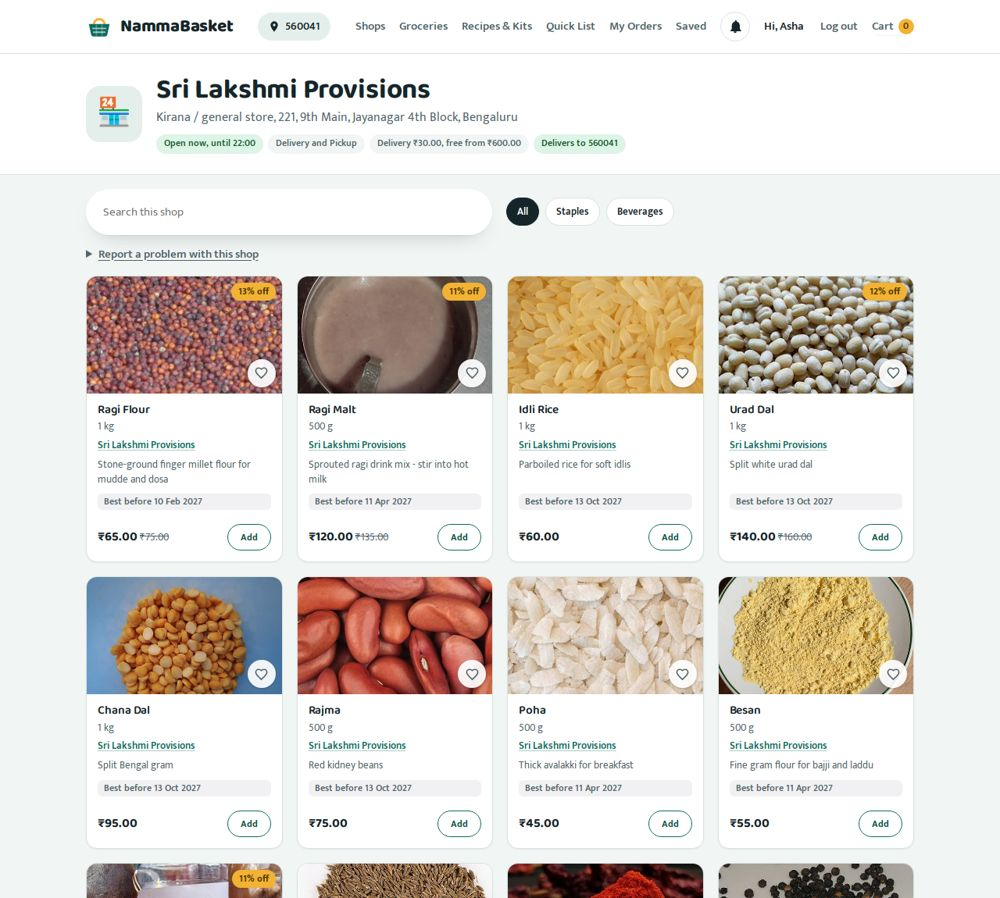
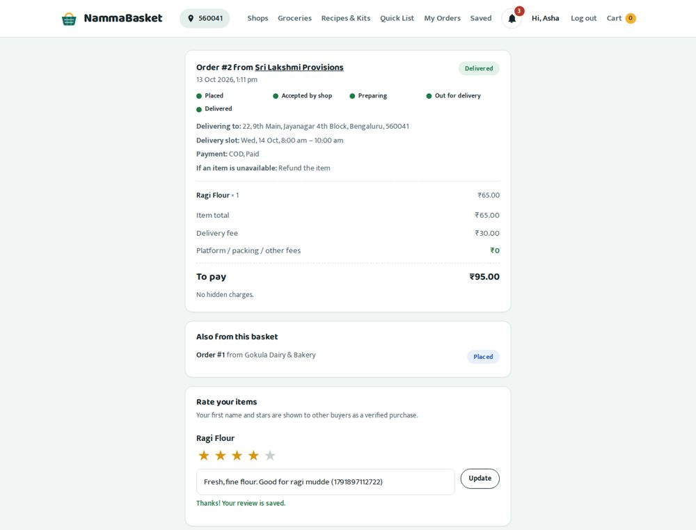
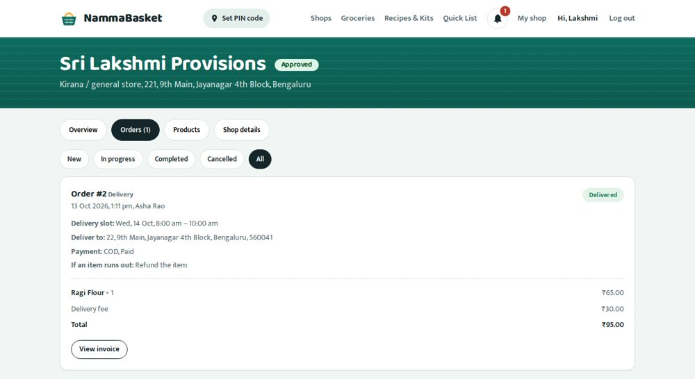
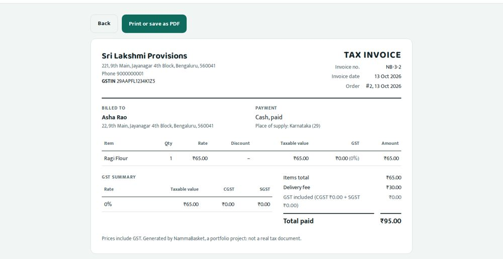

# NammaBasket — Your Neighbourhood Shops, All in One Basket

A multi-vendor marketplace for neighbourhood kirana shops in Bengaluru. Buyers find the shops that deliver
to their PIN code, fill **one basket from several shops**, and pay once. Each shop gets its own order to
pack and deliver, or the buyer picks it up. Shop owners apply, get approved by an admin, and run their
shop from a dashboard.

A portfolio project by [Surya Prasanth G](https://github.com/suryaprasanth740), built and tested the way a
QA engineer would: **164 API tests run on both H2 and PostgreSQL, plus 27 browser tests with accessibility scans** on every push.

**Live demo:** _not deployed yet: see [Deploying](#deploying)._ The earlier single-shop version, FreshCart,
is on the `main` branch.
**Stack:** Java 17 · Spring Boot 3 · Spring Data JPA · PostgreSQL · Flyway · HTML/CSS/vanilla JavaScript ·
JUnit 5 + MockMvc · Playwright · GitHub Actions · Docker

| Shop page with real product photos | Order with a delivery slot and a star rating |
|---|---|
|  |  |
| **Seller dashboard: order steps** | **GST invoice** |
|  |  |

_These screenshots are taken automatically by the browser tests from the real running app._

---

## Contents

- [What it does](#what-it-does)
- [Quality and testing](#quality-and-testing)
- [Tech stack and project layout](#tech-stack-and-project-layout)
- [Running it locally](#running-it-locally)
- [Configuration (environment variables)](#configuration-environment-variables)
- [Database and migrations](#database-and-migrations)
- [Running the tests](#running-the-tests)
- [Building](#building)
- [Deploying](#deploying)
- [Demo accounts and test data](#demo-accounts-and-test-data)
- [API reference](#api-reference)
- [Honest limitations](#honest-limitations)

## What it does

**Buyers**
- Set a PIN code (or share a location) to see the shops that deliver there, nearest first.
- One basket from several shops. Delivery or pickup is chosen **per shop**, and the bill shows each shop's
  fee, free-delivery amount and minimum order.
- One checkout turns into one order per shop, all paid together: cash on delivery or a demo UPI screen with
  success, failure and timeout.
- Book a 2-hour **delivery or pickup slot** for today or tomorrow, or choose "as soon as possible".
- **Save for later** with a heart, and move items between the saved list and the cart.
- **Rate and review** products after delivery. Ratings show on product cards and shop pages.
- A **notification bell** for order updates, a printable **GST invoice**, "order again", and missing-item
  refunds within 48 hours.
- Smart shopping: paste a shopping list ("2 kg thakkali, 1 litre haalu…"), turn recipes and festival kits
  into a cart, keep to a monthly budget with cheaper swaps, and get "running low" reminders.

**Shop owners**
- Apply to sell. The shop stays hidden until an admin approves it, and a rejected application can be fixed
  and sent again.
- Dashboard with today's sales, new orders, best sellers and low stock, worked out from real orders.
- Products with MRP and discount, GST rate, best-before date and a photo (shrunk in the browser,
  ≤ 300 KB, stored in PostgreSQL).
- Orders move step by step: accept → prepare → out for delivery / ready for pickup → delivered.
  Reject with a reason, which returns the stock.
- Shop settings: hours, PIN codes served (`560xxx` = a whole area), delivery fee, minimum order,
  pause orders, time slots with a capacity, and a GSTIN for tax invoices.

**Admins**
- Approve, reject, suspend and reactivate shops and accounts. Every action is written to an audit log.
- Handle buyer reports by hiding a product or suspending a shop, and hide abusive reviews.
- Manage categories and promotions, search all orders, and see marketplace stats.

## Quality and testing

Full test plan, requirement traceability, detailed test cases and defect log:
**[docs/TEST_PLAN.md](docs/TEST_PLAN.md)**. Final security, accessibility and responsiveness review:
**[docs/FINAL_REVIEW.md](docs/FINAL_REVIEW.md)**.

| Level | What | Count |
|---|---|---|
| API / integration | JUnit 5 + MockMvc: status codes, response bodies **and** database effects | 164 |
| Database | The same 164 tests on PostgreSQL 16 in CI, as well as H2 | 164 × 2 |
| Browser (end-to-end) | Playwright in Chrome against the real app: buyer → seller → buyer → admin journey, every page on desktop and phone, keyboard-only use, XSS and security headers | 27 |
| Accessibility | axe-core WCAG 2.1 A/AA scan of 26 page states; any serious or critical finding fails the build | 26 scans |
| Container | The Docker image Render runs is built, started and checked (non-root user) on every push | 1 |

Some of the edge cases that are tested:

| Risk | What the app does (and the test that proves it) |
|---|---|
| Two buyers take the **last item** or the **last slot place** at the same moment | An atomic stock update and a shop row lock: exactly one wins (`CRIT-01`, `SLOT-07`) |
| Double click / two tabs on Place order | A request id makes checkout idempotent (`CRIT-02`, `CRIT-03`) |
| One shop's item fails in a two-shop basket | All or nothing: no order for any shop, stock untouched (`MV-05`) |
| Seller A edits seller B's product, or a buyer opens another buyer's order | 404 / 403, and nothing changes (`CAT-03`, `SEC-01`) |
| Price changed or total tampered with in the browser | The bill is calculated only on the server; a different total is refused (`CRIT-07`, `CRIT-08`) |
| Coupon on a basket from several shops | Counts as one use and is split by item value; invoices take each line's share off before GST (`MV-07`, `INV-03`) |
| Order steps skipped or repeated | Only valid steps are allowed; stock is returned exactly once (`STEP-03`, `STEP-06`) |
| A server error with secrets in its message | The client sees a generic message only (`ERR-09`) |
| Negative stock or an unknown status written straight to the database | Database CHECK constraints refuse it (`DatabaseMigrationTest`) |

## Tech stack and project layout

| Layer | Choice |
|---|---|
| Backend | Java 17, Spring Boot 3.3 (Web, Data JPA, Validation), BCrypt (spring-security-crypto) |
| Database | PostgreSQL in production (e.g. Neon); in-memory H2 in PostgreSQL mode for local runs and tests |
| Migrations | Flyway (`src/main/resources/db/migration`); Hibernate only validates (`ddl-auto=validate`) |
| Frontend | Plain HTML, CSS and JavaScript served by Spring Boot (no framework, no build step) |
| Auth & security | Session cookie (HttpOnly, SameSite=Lax, Secure in production); roles BUYER / SELLER / ADMIN; CSRF header check on every change; CSP and security headers |
| Tests | JUnit 5, Spring MockMvc, AssertJ, Playwright; GitHub Actions |
| Hosting | Docker on Render (backend + pages); optional Netlify/Vercel in front, proxying `/api` |

```
grocery-web-app/
├── src/main/java/com/suryaprasanth/grocery/
│   ├── controller/      REST endpoints (auth, shops, products, cart, orders, seller, admin, reviews, ...)
│   ├── service/         Business rules (OrderService, BillingService, SlotService, ReviewService, InvoiceService, ...)
│   ├── model/           JPA entities (User, Shop, Product, Order, Checkout, Review, Notification, ...)
│   ├── repository/      Spring Data repositories
│   ├── dto/             Request and response shapes, with validation rules
│   ├── config/          Demo data, CSRF interceptor, shop rules
│   └── util/            Passwords, sessions, units, email normalising
├── src/main/resources/
│   ├── application.properties
│   ├── db/migration/    Flyway migrations (V1__initial_schema.sql, ...)
│   └── static/          Pages (*.html), css/, js/, img/products/ (bundled photos + credits.json)
├── src/test/java/...    API tests (JUnit 5 + MockMvc)
├── e2e/                 Browser tests (Playwright)
├── docs/                TEST_PLAN.md, TEST_CASES.md, NAMMABASKET_PLAN.md, screenshots
├── tools/               Helpers: photo collection, schema export, test plan inventory
├── .github/workflows/   tests.yml (CI), photos.yml, schema.yml
├── Dockerfile           Image that Render runs
├── render.yaml          Render Blueprint
├── netlify.toml / vercel.json   Optional static hosting with /api proxied to Render
└── .env.example         Every environment variable, with safe example values
```

## Running it locally

You need **Java 17** and **Maven 3.9+**. No database is needed.

```bash
git clone https://github.com/suryaprasanth740/grocery-web-app.git
cd grocery-web-app
git checkout nammabasket
ADMIN_PASSWORD='Admin@12345' DEMO_SELLER_PASSWORD='Demo@12345' mvn spring-boot:run
```

Open **http://localhost:8080**. On first start the app creates the tables (Flyway) and the demo data:
4 shops, about 100 products with photos, categories and coupons. Log in as the admin
(`admin@nammabasket.local` / the password above) or as a demo shop owner (see
[Demo accounts](#demo-accounts-and-test-data)). The in-memory database starts empty again on every restart.

**With a real PostgreSQL database** (closer to production):

```bash
docker run -d --name nb-db -e POSTGRES_DB=nammabasket -e POSTGRES_USER=nammabasket \
  -e POSTGRES_PASSWORD=change-me -p 5432:5432 postgres:16
DB_URL=jdbc:postgresql://localhost:5432/nammabasket DB_USER=nammabasket DB_PASSWORD=change-me \
  ADMIN_PASSWORD='Admin@12345' mvn spring-boot:run
```

## Configuration (environment variables)

Everything that changes between environments is an environment variable. The full list with safe example
values is in **[.env.example](.env.example)**. Copy it to `.env`, which Git ignores, and never commit real passwords.

| Variable | Default | What it does |
|---|---|---|
| `DB_URL` | in-memory H2 | JDBC URL of the PostgreSQL database, e.g. `jdbc:postgresql://ep-xxx.aws.neon.tech/neondb?sslmode=require` |
| `DB_USER` / `DB_PASSWORD` | `sa` / empty | Database login |
| `PORT` | `8080` | HTTP port (Render sets it) |
| `COOKIE_SECURE` | `false` | `true` makes the login cookie HTTPS-only. Set it in production. |
| `ADMIN_EMAIL` | `admin@nammabasket.local` | Admin account created on first start |
| `ADMIN_PASSWORD` | random | The admin's password. If empty, a random one is printed once in the log. **Set it in production.** |
| `DEMO_SHOPS` | `true` | Adds 3 demo shops with products and photos next to the starter demo kirana |
| `DEMO_SELLER_PASSWORD` | random (no login) | Lets you log in as the demo shop owners |

Business rules (delivery fee, COD limit, cart limit, UPI timeout, login lockout…) are plain settings in
`application.properties` under `app.*`, each with a comment.

## Database and migrations

- **Flyway owns the schema.** On start-up Flyway runs any migration in `src/main/resources/db/migration`
  that hasn't run yet, and records it in the `flyway_schema_history` table.
- **Hibernate only checks.** With `spring.jpa.hibernate.ddl-auto=validate`, the app refuses to start if a
  table or column the code needs is missing. A forgotten migration is caught by the first test run, not by
  a user.
- **The same SQL works everywhere.** Local runs and the H2 tests use H2 in PostgreSQL mode, and CI runs every
  test on real PostgreSQL 16 too.
- **The database protects itself.** Enum columns have CHECK constraints, stock can't go below 0, emails and
  reviews have unique keys, and every relation has a foreign key.

**To change the schema**
1. Change the entity in `model/`.
2. Add a new file `V2__what_changed.sql`, then `V3__…`, and so on. **Never edit a migration that has already
   run anywhere.** Flyway checks a checksum and stops if an applied file changes.
3. Adding a value to an enum stored as text also means changing its CHECK constraint, for example:
   `alter table orders drop constraint ck_orders_status; alter table orders add constraint ck_orders_status check (status in (...));`
4. Not sure what SQL Hibernate expects? Run **Actions → Schema export**. It saves the DDL for the current
   entities to the `schema-export` branch (see `tools/schema/README.md`).
5. Run `mvn verify`. If the migration and the entities disagree, every test fails at start-up with
   Hibernate's "Schema-validation" message.

**Coming from FreshCart?** The FreshCart database on `main` was created by Hibernate (`ddl-auto=update`),
not by Flyway. Point NammaBasket at a **new, empty** PostgreSQL database (create a new database or project in
Neon). Flyway refuses to run on a non-empty database that has no migration history, so the old one can't
be changed by accident. FreshCart keeps running on its own database.

## Running the tests

```bash
mvn verify                       # all 164 API tests on in-memory H2

# the same tests on PostgreSQL
DB_URL=jdbc:postgresql://localhost:5432/nammabasket DB_USER=nammabasket DB_PASSWORD=change-me mvn verify
```

Browser tests: start the app, then follow **[e2e/README.md](e2e/README.md)**, which comes down to
`cd e2e && npm install && npx playwright install chromium && npm test`.

GitHub Actions (**Actions → Build and test**) runs four jobs on every push and pull request:

| Job | What it runs |
|---|---|
| API tests (H2) | `mvn verify` |
| API tests (PostgreSQL) | `mvn verify` against a PostgreSQL 16 service container |
| Browser tests (Playwright) | Starts the jar on PostgreSQL, runs `e2e/`, publishes screenshots to the `ci-screenshots` branch |
| Docker image | Builds the image Render deploys, starts it, checks it answers and runs as a non-root user |

The test totals appear on each run's summary page. If anything fails, the reason is shown there too.

## Building

```bash
mvn clean package                 # target/grocery-web-app.jar (runs the tests first)
java -jar target/grocery-web-app.jar

docker build -t nammabasket .     # the image Render runs
docker run -p 8080:8080 --env-file .env nammabasket
```

## Deploying

The free setup: **Neon** for PostgreSQL and **Render** for the app. Optionally put **Netlify or Vercel** in
front for a nicer URL.

1. **Database (Neon).** Create a project at [neon.tech](https://neon.tech) and copy the connection details.
   Make the JDBC URL from them: `jdbc:postgresql://<host>/<database>?sslmode=require`, plus the user and password.
   Use an empty database; Flyway creates the tables.
2. **App (Render).** New → **Blueprint** → choose this repository and the `nammabasket` branch. Render reads
   [`render.yaml`](render.yaml) and asks for the secret values: `DB_URL`, `DB_USER`, `DB_PASSWORD`,
   `ADMIN_EMAIL`, `ADMIN_PASSWORD` and, optionally, `DEMO_SELLER_PASSWORD`. `DEMO_SHOPS=true` and
   `COOKIE_SECURE=true` are already set. Render builds the `Dockerfile`, which runs the app on port 8080
   as a non-root user. The first deploy takes a few minutes.
3. **Check it.** Open `https://<your-service>.onrender.com`. The log should show Flyway
   `Migrating schema "public" to version "1 - initial schema"`, then `Started GroceryApplication`. Log in at `/login.html` with your admin email.
4. **Optional front door (Netlify or Vercel).** Change the Render URL in `netlify.toml` or `vercel.json`,
   then import the repository. They serve the pages and pass `/api/*` to Render, so the login cookie works
   without CORS.
5. **Keep it honest.** The free Render plan sleeps when idle, so the first visit can take up to a minute.
   The pages keep retrying while it wakes. Open the site a minute before showing it to someone.

## Demo accounts and test data

| What | Value |
|---|---|
| Admin | `ADMIN_EMAIL` / `ADMIN_PASSWORD` (default email `admin@nammabasket.local`) |
| Demo shop owners (password = `DEMO_SELLER_PASSWORD`) | `lakshmi.provisions@demo.nammabasket.in` (Sri Lakshmi Provisions, has a GSTIN) · `hasiru.tarkari@demo.nammabasket.in` (Hasiru Tarkari Angadi) · `gokula.bakery@demo.nammabasket.in` (Gokula Dairy & Bakery) |
| Buyers | Sign up at `/register.html` |
| PIN codes | Any `560xxx` (Bengaluru) is served; e.g. `110001` is not |
| Coupons | `FRESH50` (₹50 off above ₹299) · `SAVE10` (10% up to ₹100 above ₹199) · `BIG100` (₹100 off above ₹999) · `OLD20` (expired, always refused) |
| Payment | Cash on delivery up to ₹3000, or the demo UPI screen (choose success or failure) |

## API reference

All endpoints are under `/api` and use JSON. Requests that change something must send the header
`X-Requested-With: XMLHttpRequest` (CSRF protection). Errors always come back as `{"message": "..."}` with a
4xx or 5xx status.

| Area | Endpoints |
|---|---|
| Auth | `POST /auth/register` · `POST /auth/register-seller` · `POST /auth/login` · `POST /auth/logout` · `GET /auth/me` |
| Catalogue | `GET /categories` · `GET /products` · `GET /products/search` (paged) · `GET /products/{id}` · `GET /images/{id}` |
| Shops | `GET /shops?pincode=&lat=&lng=` · `GET /shops/{slug}` · `GET /shops/{id}/slots` · `GET /shops/{id}/reviews` · `GET /delivery/check?pincode=` |
| Cart & saved | `GET /cart` · `POST /cart/add` · `PUT /cart/update` · `DELETE /cart/remove/{productId}` · `DELETE /cart/clear` · `POST /cart/accept-prices` · `POST /cart/save-for-later/{productId}` · `GET /saved` · `POST/DELETE /saved/{productId}` · `POST /saved/{productId}/move-to-cart` |
| Orders | `POST /orders/quote` · `POST /orders/checkout` · `GET /orders` · `GET /orders/{id}` · `POST /orders/{id}/pay` · `POST /orders/{id}/cancel` · `POST /orders/{id}/issues` · `POST /orders/{id}/reorder` · `GET /orders/{id}/invoice` |
| Reviews & reports | `GET/POST /products/{id}/reviews` · `GET /reviews/mine` · `GET /reports/reasons` · `POST /reports` |
| Notifications | `GET /notifications` · `POST /notifications/{id}/read` · `POST /notifications/read-all` |
| Smart shopping | `POST /smart-list/parse` · `GET /recipes` · `GET /recipes/{id}?servings=` · `GET/PUT /budget` · `GET /reorder` · `POST /cart/add-many` · `POST /cart/swap` |
| Seller | `GET/PUT /seller/shop` · `POST /seller/shop/resubmit` · `PUT /seller/shop/accepting` · `GET/POST /seller/products` · `PUT /seller/products/{id}` (`/stock`, `/active`) · `POST /seller/images` · `GET /seller/orders` · `GET /seller/orders/{id}` · `PUT /seller/orders/{id}/status` · `POST /seller/orders/{id}/reject` · `GET /seller/orders/{id}/invoice` · `GET /seller/summary` |
| Admin | `/admin/shops` (approve, reject, suspend, reactivate) · `/admin/users` · `/admin/orders`, `/admin/orders/search`, `/admin/orders/{id}/status`, `/admin/orders/{id}/invoice` · `/admin/products` · `/admin/reports` · `/admin/reviews` · `/admin/categories` · `/admin/coupons` · `/admin/issues` · `/admin/audit` · `/admin/stats` |

## Honest limitations

- **No real payments.** UPI is a demo screen. A real app would use Razorpay or PhonePe and trust only their signed webhook.
- **One time zone.** Slots and "today" use India time (Asia/Kolkata); PIN codes are Indian.
- **Single server.** Login lockout counts live in memory and reset on restart; several servers would need Redis.
- **Not real tax documents.** Invoices follow the GST layout, but are not filed tax documents.
- **Demo stock.** Demo products get a new best-before date when theirs passes (`app.demo.refresh-expired-stock`),
  so the free demo keeps working.
- **Browser coverage.** Browser tests run in Chrome only, and there has been no manual screen-reader pass yet.
  The automated accessibility scans and the security review are in [docs/FINAL_REVIEW.md](docs/FINAL_REVIEW.md).
- **Cold starts.** The free Render plan sleeps after inactivity, so the first request can take up to a minute.

---

Product photos: Wikimedia Commons contributors, used under CC BY / CC BY-SA / CC0 / public domain.
The full list is on `/credits.html` and in `src/main/resources/static/img/products/credits.json`.
